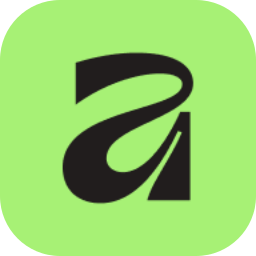

### Apa khabar?

- 🇲🇾 Malaysian based in Korea
- 🎓 ICT Convergence @ **Hanyang University ERICA**
- 🎨 UI/UX design, creative frontend & graphic design
- 📈 Data analytics, UX research & statistics
- 🔭 Currently working on **ERICA Nav** 🗺️ and an **AI Guitar Coach** 🎸

 

### 📌 Selected work

| Project | Brief |
|:--|:--|
| 🗺️&nbsp;[**ERICA&nbsp;Nav**](https://erica-nav.vercel.app) UX research · UI design | Ran a survey on wayfinding on campus. 64% struggled to find the room inside a building, so we designed a campus map built around building and room numbers. |
| ⚽&nbsp;[**Bolahh**](https://bolahh.com) UI design · Frontend | Redesign of a live futsal booking platform: tiered player cards with a tilt-and-flip interaction, an achievement badge system and a new landing page. |
| 🎸&nbsp;**AI&nbsp;Guitar&nbsp;Coach** Design · Dev | Real-time guitar coaching with pitch detection. In progress. |
| 🌐&nbsp;[**Portfolio**](https://waaafiq-work.vercel.app/) Design · Frontend | Where the case studies and graphic design live. |

### 🧰 Toolbox

&nbsp;
&nbsp;
&nbsp;

 
&nbsp;
&nbsp;
&nbsp;
&nbsp;
&nbsp;
&nbsp;
&nbsp;

### 📊 Stats

### 👁️👁️ Contacts

Always happy to chat about design, frontend or guitar 🎸

hakeemwafiq04@gmail.com

